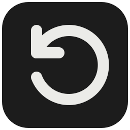

# Rewind



[English](README.md) · **Русский**

Сохраните последние минуты игры или работы за компьютером. Rewind ведёт буфер на диске и сохраняет отдельный MP4 с каждого выбранного экрана.

**Windows 11 x64 · NVIDIA NVENC · GPL-3.0-only**

[Собрать установщик Windows](#сборка-из-исходников)

## Быстрый старт

1. Запустите установщик, выберите язык и папку для повторов. По умолчанию это **Видео → Rewind**.
2. В настройках Rewind выберите экраны и нажмите **Включить**.
3. Нажмите **Alt + F10** для основного экрана или **Alt + Shift + F10** для всех записываемых экранов. Отпустите Alt и откройте клип в библиотеке.

Язык интерфейса можно изменить в настройках.

## Возможности

- Отдельное разрешение и частота кадров для каждого экрана.
- Удерживайте Alt и нажмите **F9 / F11**, чтобы изменить длительность, или **C**, чтобы отменить сохранение.
- Отдельные дорожки для системного звука, микрофона и Discord.
- Встроенная библиотека и плеер. Укажите существующий архив ShadowPlay в настройках хранения, чтобы сохранить его структуру и имена `.DVR.mp4`.

## Сравнение для локальных повторов

| Функция | ShadowPlay | OBS | Medal | Action! | **Rewind** |
| --- | :---: | :---: | :---: | :---: | :---: |
| Отдельный клип с каждого монитора одним нажатием | ❌ | ❌ | ❌ | ❌ | ✅ |
| Свои разрешение и FPS для каждого одновременно записываемого монитора | ❌ | ❌ | ❌ | ❌ | ✅ |
| Выбор длительности повтора после нажатия клавиши сохранения | ❌ | ❌ | ❌ | ❌ | ✅ |
| Открытый исходный код программы захвата | ❌ | ✅ | ❌ | ❌ | ✅ |
| Бесплатное сохранение локальных повторов без пробного срока | ✅ | ✅ | ✅ | ❌ | ✅ |
| Звук Discord на отдельной дорожке | ❌ | ✅ | ✅ | ✅ | ✅ |
| Мгновенный повтор по горячей клавише | ✅ | ✅ | ✅ | ✅ | ✅ |
| Несколько аудиодорожек в одном клипе | ✅ | ✅ | ✅ | ✅ | ✅ |

Сравниваем штатные функции одного запущенного экземпляра без плагинов. ✅ Поддерживается · ❌ Штатного режима нет.

ShadowPlay сравнивается в составе NVIDIA App. У Action! есть [30-дневный пробный период][action-trial].

[ShadowPlay][shadowplay] · [OBS][obs] ([запись][obs-output], [звук приложений][obs-app-audio], [дорожки][obs-audio], [исходники][obs-source]) · [Medal][medal] ([бесплатный режим][medal-free], [дорожки][medal-audio]) · [Action!][action] ([Time-Shift][action-replay], [звук приложений][action-audio])

[shadowplay]: https://www.nvidia.com/en-us/geforce/news/nvidia-app-download-and-features/
[obs]: https://obsproject.com/kb/obs-studio-overview
[obs-output]: https://obsproject.com/kb/standard-recording-output-guide
[obs-app-audio]: https://obsproject.com/kb/application-audio-capture-guide
[obs-audio]: https://obsproject.com/kb/multiple-audio-track-recording-guide/
[obs-source]: https://github.com/obsproject/obs-studio
[medal]: https://support.medal.tv/support/solutions/articles/48001157616-how-to-choose-your-recording-method
[medal-free]: https://medal.tv/download
[medal-audio]: https://support.medal.tv/support/solutions/articles/48001220541-multi-track-recording
[action]: https://mirillis.com/action-features
[action-replay]: https://mirillis.com/action-time-shift
[action-audio]: https://mirillis.com/action-history
[action-trial]: https://mirillis.com/activation-action-tutorial

## Системные требования

- **Windows 11 x64** и видеокарта **NVIDIA с NVENC**.
- Свободное место на диске для буфера и клипов. Объём зависит от длительности записи и настроек каждого экрана.
- Сетап включает .NET 10 Desktop Runtime. Если в системе ещё нет FFmpeg и FFprobe, для их установки понадобятся WinGet и интернет.
- Если захват зависает в эксклюзивном полноэкранном режиме, переключите игру в оконный режим.

## Сборка из исходников

Понадобятся Node.js 24, .NET 10 SDK, Visual Studio Build Tools с MSVC x64, Windows SDK с заголовками C++/WinRT и [NSIS 3.13](https://nsis.sourceforge.io/Download). Заголовок NVENC загружается при первой сборке.

1. Подготовьте x64-сборку [libmpv под LGPL](https://mpv.io/installation/) и поместите `libmpv-2.dll` и `LICENSE.LGPL` в `.cache/playback-lab/mpv/`. Сведения о проверенной версии есть в [уведомлениях о зависимостях](THIRD_PARTY_NOTICES.md).
2. Соберите сетап из корня проекта.

   ```powershell
   node build/build-nsis.cjs "C:\путь\к\NSIS\makensis.exe"
   ```

3. Запустите `Rewind-Setup.exe` из `.cache/nsis/<идентификатор-сборки>/`. При обновлении сначала удалите предыдущую версию через «Установленные приложения» Windows. Настройки и клипы сохранятся.

<details>
<summary>Проверки для разработки</summary>

```powershell
dotnet run --project tests/ReplayUiChecks/ReplayUiChecks.csproj --artifacts-path .cache/tests
dotnet run --project tests/LocalizationUiChecks/LocalizationUiChecks.csproj --artifacts-path .cache/l10n-ui-tests
node tests/check-nsis.cjs "C:\путь\к\NSIS\makensis.exe"
```

</details>

## Лицензия

Код Rewind распространяется под [GNU GPL v3.0 only](LICENSE). Лицензии и источники сторонних компонентов перечислены в [THIRD_PARTY_NOTICES.md](THIRD_PARTY_NOTICES.md).
